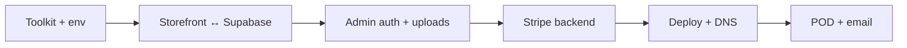

# Madcap Tees — Agent Execution Playbook

**For:** Cursor Cloud Agents, local agents, and future-you.  
**Read first:** `blockers/SUMMARY.md`  
**Deploy runbook:** `docs/DEPLOYMENT.md`

---

## Stack reality (do not assume Next.js)

| Docs say | Code actually is |
|----------|------------------|
| Next.js 15 + Server Actions | **React 19 + Vite 7 SPA** |
| `/api/stripe/webhook` | **No API routes exist** |
| `NEXT_PUBLIC_*` env vars | **`VITE_*` prefix** |

When implementing payments or webhooks, you need **Supabase Edge Functions**, **Vercel serverless**, or a **Next.js migration** — not client-only Vite.

---

## Operating rules

1. **Check `blockers/SUMMARY.md`** before scoping work.
2. **Minimize diff** — match existing patterns in `src/sections/` and `src/lib/`.
3. **Never commit secrets** — only `.env.local.example` in git.
4. **Storefront data** must go through `src/lib/api.ts`, not `src/lib/data.ts` (except seed fallback).
5. **Server keys** (`STRIPE_SECRET_KEY`, `SUPABASE_SERVICE_ROLE_KEY`) never in client bundles.
6. **Update `blockers/SUMMARY.md`** when closing a P0/P1 item.

---

## Environment workflow

```bash
cp .env.local.example .env.local
# Fill from Supabase / Stripe dashboards

npm run validate-env          # local: seed data OK without Supabase
npm run validate-env:strict   # deploy: all required vars set
```

| Variable | Client-safe? | Purpose |
|----------|--------------|---------|
| `VITE_SUPABASE_URL` | Yes | Supabase project URL |
| `VITE_SUPABASE_ANON_KEY` | Yes | Public anon key |
| `SUPABASE_SERVICE_ROLE_KEY` | **NO** | Server/admin only |
| `VITE_STRIPE_PUBLISHABLE_KEY` | Yes | Stripe.js / Checkout redirect |
| `STRIPE_SECRET_KEY` | **NO** | Create Checkout sessions |
| `STRIPE_WEBHOOK_SECRET` | **NO** | Verify webhooks |
| `VITE_SITE_URL` | Yes | Canonical site URL |

---

## Milestone sequence (recommended)



### M0 — Toolkit ✅
- `.env.local.example`, `validate-env`, `blockers/SUMMARY.md`, this playbook

### M1 — Connected catalog
- Replace `getPublishedProducts()` with `fetchProducts()` / `useProducts` in shop, home, product detail
- Gate published products in queries (`published = true`)

### M2 — Secure admin
- Supabase Auth login
- Protect admin route; check `profiles.is_admin`
- Image upload to `product-images` bucket

### M3 — Real checkout
- Edge Function or API: create Stripe Checkout Session
- Webhook: `checkout.session.completed` → insert order → clear cart
- Remove demo checkout path

### M4 — Production deploy
- Vercel static + functions
- `npm run validate-env:strict` green
- Custom domain

### M5 — Fulfillment + comms
- Printful/Printify mapping via `pod_variant_id`
- Resend order confirmation emails

---

## Verification checklist (after each milestone)

- [ ] `npm run lint`
- [ ] `npm run build`
- [ ] `npm run validate-env` (or strict if deploy-related)
- [ ] Manual: add product in admin → appears on shop within 10s
- [ ] Update `blockers/SUMMARY.md`

---

## MCP tools (account-level)

Use when authenticated:

- **Supabase** — migrations, SQL, logs, advisors
- **Stripe** — docs, webhook setup
- **Vercel** — deploy, env vars, runtime logs
- **GitHub** — PRs, CI

---

## Failure protocol

- **Security issue** → stop, classify P0, do not ship workaround in client
- **RLS/auth failure** → verify session + `is_admin` before blaming UI
- **Env errors** → run `npm run validate-env:strict`, compare to `.env.local.example`
- **Storefront stale** → confirm it's not still reading `data.ts`

---

## Related repos

| Repo | Role |
|------|------|
| `redinc23/my_publishing` | Reference operator kit (env, scripts, blockers) |
| `redinc23/standards_poor` | Cross-repo agent prompts + standards (WIP) |
| `redinc23/madcaptees` | This project |
